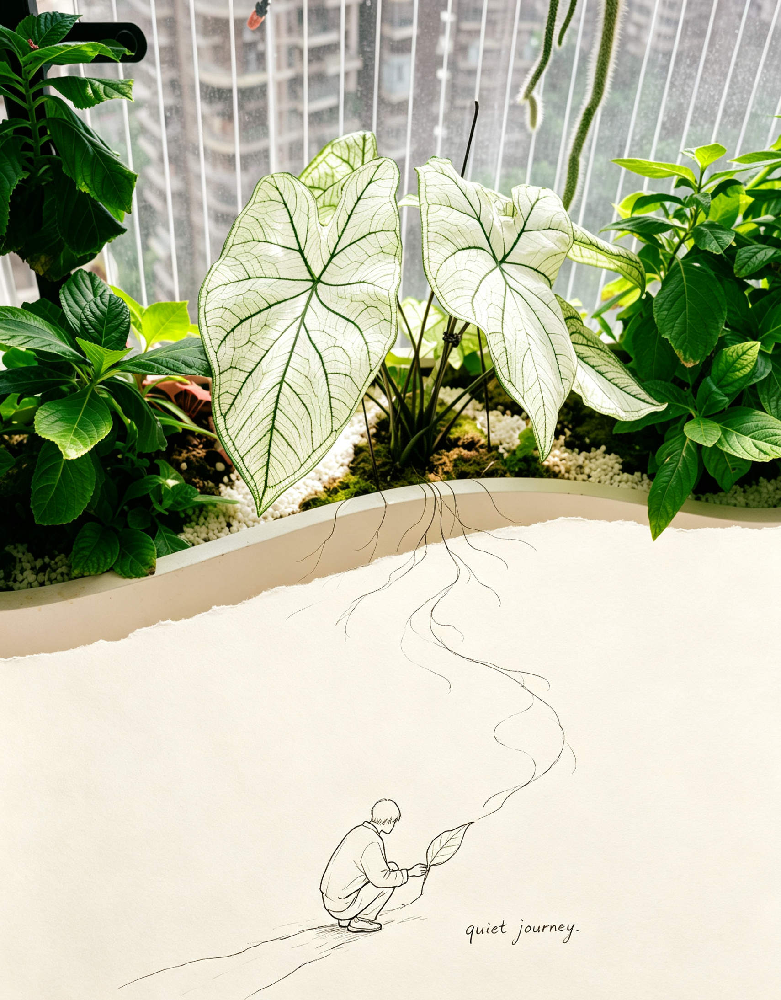
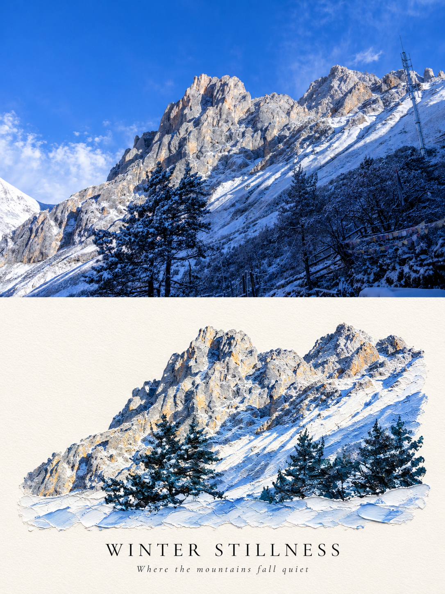
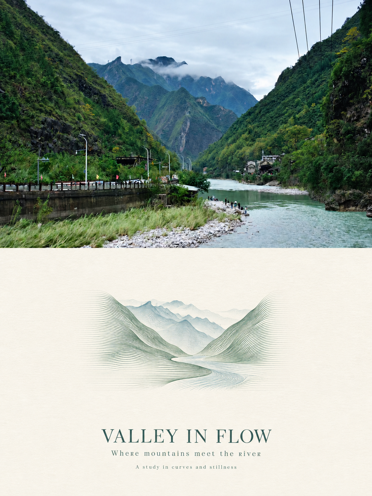

# amazing-images-template

将上传照片制作成带有设计感的海报的 Skill。提供四种可复用模板，保留原照主体，并根据当前照片组织构图、色彩与文案。

## 模板与案例

| 编号 | 模板 | 效果 | 详细规则 |
| --- | --- | --- | --- |
| 1 | 实景延伸线稿旅行海报 | 实景自然延伸为手绘线条，与小比例钢笔人物互动 | [模板 1](references/photo-line-travel.md) |
| 2 | 厚涂油画微景观对照海报 | 上半真实摄影，下半同一场景的厚涂油画微景观 | [模板 2](references/impasto-photo-poster.md) |
| 3 | 流体光栅线条雕塑双联海报 | 上半原照，下半连续柔性线条形成主体体积，低饱和油墨与大面积暖白留白 | [模板 3](references/fluid-raster-diptych.md) |
| 4 | 第二世界摄影二创海报 | 上下等高；上半忠实保留原照，下半从照片独有的视觉结构推演可互动的“第二世界” | [模板 4](references/second-world-photo-poster.md)（暂无案例） |

### 模板 1：实景延伸线稿旅行海报

默认 3:4 竖版，上方约 60%–70% 保留摄影质感，下方为暖白象牙纸面。将照片中的道路、水面、植物或建筑轮廓延伸为纤细线条，加入与其互动的小比例线稿人物和简短旁白。

案例中的植物线条从实景延伸至纸面，与下方人物形成联系。



### 模板 2：厚涂油画微景观对照海报

默认 3:4 竖版，上下各占 50%，中间直接相接。上半保留真实照片，下半将同一主体与空间关系提炼为带刮刀肌理、颜料堆叠和浮雕感的油画微景观，搭配暖白留白及克制的标题、副文。

案例以雪山照片与同一山景的厚涂油画形成上下对照。



### 模板 3：流体光栅线条雕塑双联海报

默认 3:4 竖版，上下各占 50%，水平自然分界。上半完整保留原照，下半以同一照片为唯一依据，从连续、平行、极细的柔性曲线中形成主体体积；雕塑仅占下区约 20%–35%，搭配低饱和主色、暖白纸面留白和少量英文排版。无独立描边、真实三维材质或拼贴装饰。

案例以山谷与河流照片为依据，将山势与水流转译为连续柔性线条。



案例仅用于展示风格，主体、配色和文案会依据你上传的照片调整。案例中已有的水印不作为生成要求。

### 模板 4：第二世界摄影二创海报

默认 3:4 竖版，上下严格等高。上半尽可能忠实保留摄影原图；下半以暖米色纸面留白为底，依据照片里最有辨识度的视觉结构，推演出只属于这张照片的“第二世界”。剪贴外形和 0–3 个可选的黑色线稿人物都需真正参与解释或使用照片结构，并配一句自然轻松的英文手写旁白。不套用固定撕纸边或重复动作。

本模板暂无案例。请查看[模板 4 规则](references/second-world-photo-poster.md)。

## 使用方式

在支持 Skill 的助手中加载本目录的 [SKILL.md](SKILL.md)，并保留 `references/` 与 `example/` 目录，以便读取模板规则和展示案例。

1. 上传需要处理的原照，并调用 `amazing-images-template`。
2. 未指定模板时，助手会展示四个模板的名称、视觉说明及可用案例图片，供你选择；模板 4 暂无案例时会注明这一点。
3. 回复编号、模板名称或明确的风格描述；已指定模板时会展示对应案例并继续处理，无需再次确认。
4. 可补充“无字”“使用指定标题”“保留原比例”等要求。新图使用“继续”或“同款”可沿用当前对话已确认的模板。

示例请求：

```text
使用 amazing-images-template，先展示模板案例让我选择。
```

```text
使用 amazing-images-template 的模板 1 处理这张照片，保留原比例，不要文字。
```

```text
使用 amazing-images-template 的模板 2 处理这张照片，标题为 WINTER STILLNESS。
```

需要实际出图时，宿主须支持带参考图的图片生成或编辑工具；仅需提示词时可以明确提出，助手会按照片内容组装提示词。没有原照时需要先上传，案例图片不能代替原照。多张原照分别生成独立成品。

## 文件说明

| 文件 | 用途 |
| --- | --- |
| [SKILL.md](SKILL.md) | 技能入口、模板选择、案例预览与共用执行规则 |
| [references/photo-line-travel.md](references/photo-line-travel.md) | 模板 1 的提示词与验收规则 |
| [references/impasto-photo-poster.md](references/impasto-photo-poster.md) | 模板 2 的构图、材质与验收规则 |
| [references/fluid-raster-diptych.md](references/fluid-raster-diptych.md) | 模板 3 的完整提示词、构图与验收规则 |
| [references/second-world-photo-poster.md](references/second-world-photo-poster.md) | 模板 4 的照片观察方法、提示词、避免项与验收规则 |
| [cases.json](cases.json) | 网站案例展示清单；映射案例文案和 `example/` 图片 |
| [references/impasto-prompt.md](references/impasto-prompt.md) | 模板 2 的提示词组装与定向修正 |
| [example/template-1.png](example/template-1.png) | 模板 1 案例图片 |
| [example/template-2.png](example/template-2.png) | 模板 2 案例图片 |
| [example/template-3.png](example/template-3.png) | 模板 3 山谷河流案例图片 |

## 网站案例同步

`cases.json` 是案例展示清单。新增案例图片到 `example/` 后，在该 JSON 的 `cases` 数组登记唯一 `id`、标题、简介、图片文件名和展示顺序。网站仓库会在本地启动或部署构建时读取清单，并将图片复制到网站自己的静态资源目录；不要在网站组件里另维护案例列表。

新增模板时，请提供独立规则文件并同步更新本 README 和 Skill 中的模板目录。案例尚未提供时标明暂无案例；补充案例后使用 `example/template-N.png` 并更新预览链接。
